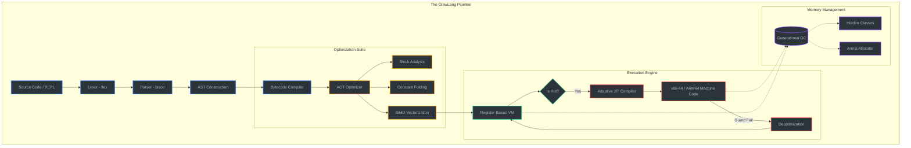

# GlowLang: Natural Language, Native Speed

GlowLang is an adaptive, high-performance systems programming language designed to be as readable as natural language while executing at native C/C++ speeds.



## Core Philosophy
GlowLang bridges the gap between high-level human readability and low-level mechanical sympathy. It is a **production-grade systems language** featuring:
- **Register-Based Virtual Machine**: Eliminates stack-shuffling overhead for maximum VM efficiency.
- **Adaptive JIT Compilation**: Automatically compiles hot paths into specialized native machine code (x86-64/ARM64).
- **SIMD Auto-Vectorization**: Collapses numeric loops into hardware-parallel instructions for AI/ML workloads.
- **Generational GC**: Minimizes pause times via Nursery/Old-Gen tiers and precision write barriers.

## Key Features
- **Natural Syntax**: Use keywords like `blueprint`, `action`, `every`, `is`, and `is not`.
- **Industrial Concurrency**: OS threads with a Global Interpreter Lock (GIL) and `spawn`/`can` primitives.
- **Rich Ecosystem**: Native bindings for **SQLite**, **Redis**, **OpenSSL**, **HTTP**, and **X11 Graphics**.
- **Modern OOP**: Hidden Classes (Shapes), Traits, and speculative property access optimization.

## Quick Start

### Building from Source
Ensure you have `gcc`, `flex`, `bison`, `libssl`, and `libsqlite3` installed:

```bash
make
```

### Running a Script
```bash
./bin/glowlang examples/hello.glow
```

### Interactive REPL
```bash
./bin/glowlang
```

## The Ecosystem
GlowLang ships with powerful native modules:
- **`tensor`**: Matrix multiplication, transposition, and SIMD-accelerated math.
- **`db`**: Full support for SQLite querying and native Redis caching.
- **`gui`**: Native X11 windowing and event-driven rendering.
- **`net`**: Scalable TCP/HTTP servers and clients.

## Performance Highlights
- **1.86 Billion IPS** peak JIT performance.
- **Fibonacci 30** in **0.048s** (Native C-tier speed).
- **SIMD Array Add** of 1M elements in **0.003s**.

---
*GlowLang: The Industrial Revolution of Natural Programming.*
